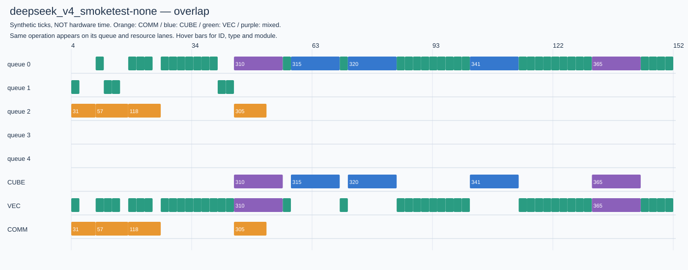
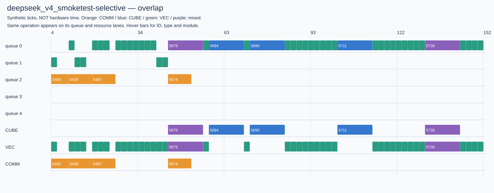
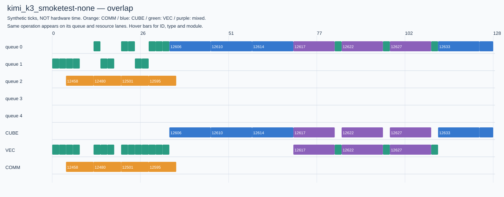

# 独立 DES 原型穿刺报告

## 结论

在当前完整 Meta 源图和显式假设耗时下，“逻辑队列／事件依赖 + 资源容量 + 捕获顺序仲裁”可执行，四组图均存在 FSDP 通信与模型计算重叠。所有节点被执行一次，所有前驱完成约束和资源互斥检查通过；AG、RS、AR 延迟会传播到下游模型计算。此结论验证调度机制的可行性，不证明真实硬件性能或实际最优调度。

本目录全部在 `/tmp/des-prototype`，没有修改仓库。原型 DES 仅依赖 Python 标准库；训练依赖仅用于抓取输入。

## 实际输入与环境

- 源码：`dc2b6f7a21082bb74c001fb4e05b9fe5ff9cc526`，抓取前工作树干净。
- 容器：`ttsim`；Python 3.12.14、torch 2.14.0+cpu、torch-npu 2.14.0.dev20260918、torchtitan 0.3.0。
- DSV4/Kimi smoketest，各 AC none/selective；world=4、DP replicate=2、EP=2、logical rank=0、seq_len=128、MTP=0、量化关闭。
- 从 `captured_workload` 导出全量 L0 源节点，保留 FSDP 打包／拷贝、元数据节点、流等待、依赖和通信注记。未使用隐藏 FSDP 工作的投影视图。
- JSON 是 L0 调度输入快照；未导出全部 Python WorkloadGraph、保存槽或 MemoryPlan。DES 不重新估算内存，也不执行 L2 多 rank 联合通信匹配。
- 捕获出现上游弃用、autograd probe 和 FSDP view 警告；Meta 捕获成功不等于这些路径的硬件数值已验证。

## 模型与算法

资源容量各为 1：CUBE、VEC、COMM；不可抢占。每种就绪资源组合有独立小顶堆，以 `(seq_idx, id)` 仲裁；多个资源需求一次性获取。先处理同一时刻全部完成事件，再将零资源节点传播到不动点，随后启动所有可执行工作。没有 topo 层级 barrier，不枚举拓扑排序。

现有前驱和逻辑 stream 顺序均保留。按 stream/捕获顺序检查相邻节点，缺边时添加显式队列边；四组实际数据均新增 0 条。设备节点无 stream 时进入标记为 unknown-device 的保守独立回退队列；四组实际数据中该回退节点均为 0。因此实测并发来自捕获关系，不是人为删除依赖或虚构异步流。

回退队列不能证明与已知默认流的关系；若未来遇到这类节点，应补充默认流识别或拒绝作严格顺序保证。

### 分类及假设耗时

| 分类 | 资源 | 假设 ticks | 说明 |
|---|---|---:|---|
| view/alias/detach、autograd wrapper | 无 | 0 | 保留依赖，不当设备计算 |
| empty/new_empty 等未初始化分配 | 无 | 0 | 不模拟 allocator 延时或内存容量 |
| stream_wait/wait_tensor | 无 | 0 | 依赖未完成仍不能通过 |
| CPU 操作、profiler 标记 | 无 | 0 | 忽略 Host 耗时；不冒充 VEC 工作 |
| mm/bmm/grouped_mm | CUBE | 12 | 不按 shape 预测性能 |
| 注意力等融合、卷积 | CUBE+VEC | 12 | 粗粒度保守占用假设，不是 kernel 硬件分类结论 |
| collective | COMM | 8 | 单 rank、单通信资源近似 |
| vector/copy/FSDP packing | VEC | 2 | 忽略独立 DMA 与共享带宽 |
| 未识别算子 | VEC | 2 | 显式标为 fallback，详见 classification.csv，不静默置零 |

元数据识别采用 dispatcher 名称白名单，仅用于这些捕获快照。通用实现还需核对 alias/schema，不能把可能发生拷贝的高层 reshape 一概作为零开销。

## 四组结果

下表单位均为 synthetic ticks，不是微秒；重叠比例是 FSDP 通信忙时中与模型计算重叠的占比，不是加速比。模型计算排除了 framework_scopes 标记的 FSDP 工作。

| case | 节点 | 总时长 | FSDP 通信忙时 | 与模型计算重叠 | 占比 | 未分类节点 |
|---|---:|---:|---:|---:|---:|---:|
| deepseek_v4_smoketest-none | 5369 | 6830 | 272 | 102 | 37.5% | 401 |
| deepseek_v4_smoketest-selective | 7012 | 8160 | 272 | 102 | 37.5% | 464 |
| kimi_k3_smoketest-none | 4106 | 6110 | 256 | 132 | 51.6% | 259 |
| kimi_k3_smoketest-selective | 5438 | 7082 | 256 | 120 | 46.9% | 288 |

未分类节点仍较多，结果不能用于比较模型性能。通信耗时额外按 0.5 倍和 2 倍重跑，四组仍保持非零通信／计算重叠；完整数值在 `results/summary.json`。

## 验证与反例

- 6 个独立小测试通过：晚到无源任务、通信重叠与等待、资源原子获取、零资源分类、队列补边与确定性、环检测。
- 四组真实捕获图：全部完成、无悬空依赖、无前驱违约、无资源超订。
- 每组分别将一个有模型后继的 AG、RS、AR 延长 1000 ticks，共 12 次检查；被选中模型后继的开始时间均延后 1000 ticks。
- 每组还执行全资源串行参照，以及两种通信时长敏感性试验；串行参照不是“旧 topo 算法”的复刻，也不是硬件性能基线。

### 第一个问题的最小反例

AG(COMM,10) → A(CUBE,3)，后层 E(CUBE,20) 没有数据前驱，但与 A 属于同一顺序队列。仅按 ready 中较小 ID 优先：E 在 0 开始，A 被挤到 20 才能开始。加入队列 A→E：A 在 10 开始，E 在 13 开始。此例总完成时间反而可能更长；目标是忠实表达指定队列顺序，不是偷换为 makespan 优化。

### 对 empty 的处理

empty 不占 CUBE/VEC，因而不会抢占计算资源。有真实初始化工作的 zeros/fill/clone/copy 不归入 empty 类。当前保留源图已有的 empty 流依赖是一种保守做法；即使零资源节点在 0 完成，也不代表真实内存提前分配。不能使用本时间线推导显存峰值。

## 可视化

每组提供 full（全图）和 overlap（局部放大）SVG；顶部按逻辑队列，底部按资源。一个节点在队列与资源中各显示一次，混合算子在两个资源轨道显示。悬停可查看 ID、类型和模块。零耗时节点留在 CSV/JSON 中，不画成占用条。

### deepseek_v4_smoketest-none

[全图时间线](results/deepseek_v4_smoketest-none-full.svg) · [全部节点](results/deepseek_v4_smoketest-none.csv) · [分类明细](results/deepseek_v4_smoketest-none.classification.csv)

### deepseek_v4_smoketest-selective

[全图时间线](results/deepseek_v4_smoketest-selective-full.svg) · [全部节点](results/deepseek_v4_smoketest-selective.csv) · [分类明细](results/deepseek_v4_smoketest-selective.classification.csv)

### kimi_k3_smoketest-none

[全图时间线](results/kimi_k3_smoketest-none-full.svg) · [全部节点](results/kimi_k3_smoketest-none.csv) · [分类明细](results/kimi_k3_smoketest-none.classification.csv)

### kimi_k3_smoketest-selective

[全图时间线](results/kimi_k3_smoketest-selective-full.svg) · [全部节点](results/kimi_k3_smoketest-selective.csv) · [分类明细](results/kimi_k3_smoketest-selective.classification.csv)

## 复现

从解压后的原型目录执行（不需要训练环境）：

```bash
python3 -m unittest -v test_des
python3 des.py data results
python3 report.py
```

`capture.py` 仅在需要重新生成输入时于原训练容器执行，默认输出容器 `/tmp/des-prototype-data`。保存的 JSON 可直接重放，不需要容器。

## 后续应完善的边界

1. 资源映射需要 kernel 与预测器证据；当前 unknown→VEC、混合 kernel 原子占两资源只是显式近似。
2. 未建模 Host 下发速率、有限队列容量、DMA、内存带宽竞争、内部 kernel 流或设备真实仲裁。
3. 不保证没有流信息时的真实顺序；独立回退队列只提供队列内保守约束。
4. Meta Event.query/synchronize 的模拟边界仍存在，不能由当前结果证明任意框架同步语义完整。
5. 多 rank rendezvous、通信网络竞争及重新调度后的内存释放需要单独设计。
6. 如果删去已捕获的 stream/control 边，只保留 tensor DAG，本原型的结果与保证不再成立。
