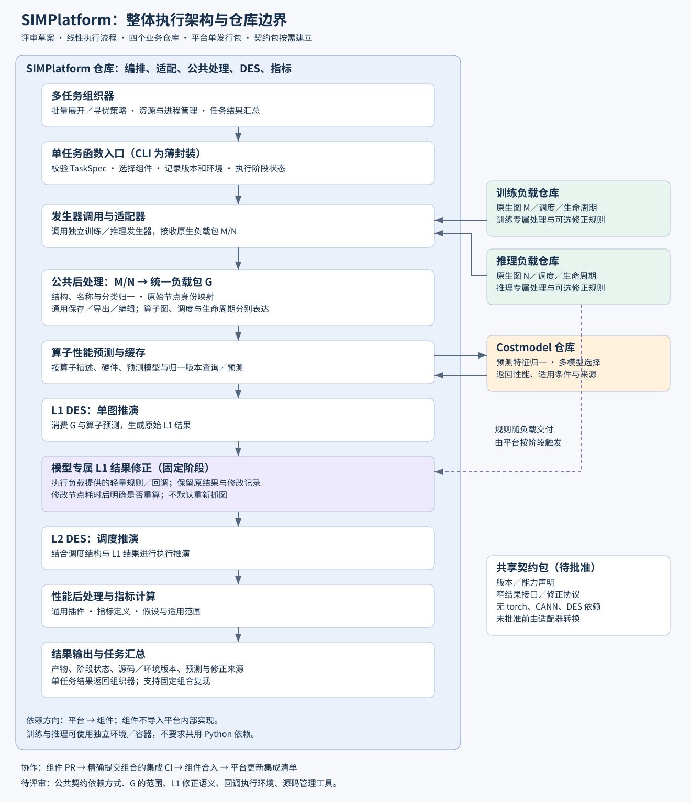

# SIMPlatform 整体架构与多仓协同方案（评审草案）

本文汇总整体需求、建议架构、仓库职责和协同开发流程，用于计划评审。除现有训练负载仓库外，其余业务仓库尚处初始化阶段。本文是设计建议，不表示相关组件已经实现，也不把建议方案视为已批准决策。

配套文件：`architecture.svg`（可独立打开的架构图）。


## 评审包导航

- 本文：整体需求、架构、生产项目布局、多仓协作与初始化计划。
- [DES 设计与开发建议](DES设计与开发建议.md)：确定性执行模型、框架选型、穿刺结论和生产化计划。
- [独立原型报告](des-prototype/README.md)：四组实际捕获结果、假设、测试、时间线和复现方法。
- [整体架构图](architecture.svg)：流程与仓库边界；局部 DES 时间线位于 `des-prototype/results/`。

原型是设计参考，不是已完成的生产后端；不需要将临时原型直接复制到训练仓库。

## 1. 已确认的需求与边界

整个系统用于生成训练／推理负载，结合算子性能预测和离散事件仿真（DES），输出性能指标，并支持批量任务和寻优。

1. SIMPlatform 负责串联完整流程。最外层多任务组织器生成独立任务、管理执行进程并汇总结果；单任务 CLI／函数入口负责参数构造和执行。
2. 当前 torchtitan-npu-simulator 仓库承担训练负载发生器职责；另有独立推理负载发生器仓库。
3. 两个发生器分别维护 dispatch 捕获、框架适配、生命周期、专属优化和图处理逻辑。允许必要的重复实现，不强求共同捕获框架或相同内部数据结构。
4. 发生器分别输出原生表达 M、N，可能包括 L1 算子图、调度图、生命周期信息及模型专属后处理。
5. 发生器应尽可能独立开发和演进，不导入 SIMPlatform 的内部实现。
6. 公共后处理负责将 M/N 转为 DES 可消费的统一表达 G，并提供名称归一、分类、保存、导出和编辑等通用能力。
7. 算子性能预测调用独立 Costmodel 仓库，该仓库归一算子元信息并管理多种预测模型，返回性能及附加元数据。平台侧提供预测缓存。
8. 性能执行链包括 L1 DES 单图推演、L2 DES 调度推演、性能后处理、指标计算与结果输出。
9. 负载侧可提供轻量模型专属回调，在 L1 预测完成后修正结果，例如缩放 X 到 Y 对应算子的耗时。此需求不要求重新抓图或建立普遍的反馈迭代流程。
10. 过去存在多个仓库必须同步合入、互相锁定分支和提交的问题；本次设计需要减少这种协同成本。

## 2. 推荐的总体方案

采用“四个主要业务仓库 + 平台单发行包、内部模块化 + 平台单向锁定集成版本”。公共契约先明确接口，共享契约包按需批准后建立。运行流程保持线性，模型专属修正在固定阶段执行。



### 2.1 控制流程

- 多任务组织器只生成 TaskSpec、分配资源、调度任务和汇总结果，不复制单任务业务逻辑。
- 单任务函数是唯一业务入口。CLI 负责解析参数、读取配置、调用函数和输出退出码；批量与寻优也调用同一接口。
- 任务执行阶段显式记录状态与产物。失败应保留具体阶段、组件版本及错误，不将部分结果标记为完整成功。
- 发生器可独立执行；平台通过适配器集成，避免平台编排逻辑侵入模型或框架。

### 2.2 数据与产物

| 产物 | 内容 | 边界 |
| --- | --- | --- |
| TaskSpec | 负载类型、模型配置、并行配置、硬件目标、预测与仿真选项 | 校验后交给单任务运行器 |
| 原生负载包 M/N | 原生算子图、调度、生命周期、假设、来源、可选修正规则 | 由发生器定义和维护 |
| 统一负载包 G | 统一算子描述、依赖、调度表达、生命周期及来源映射 | 面向公共消费，不等同于某个 DES 的内部对象 |
| 算子预测结果 | 性能估计、单位、适用条件、模型版本、未知状态 | 不反向覆盖原始捕获事实 |
| L1 原始／修正结果 | 单图结果、修正后的结果及修正记录 | 明确区分两个版本 |
| L2 与指标结果 | 调度推演结果、指标、假设和完整运行来源 | 可汇总、可追溯、可复现 |

G 不必是单一巨型图：算子图、调度关系、生命周期可以是统一负载包中的不同结构。DES 可将 G 转为自身执行表示，避免图工具、预测器和指标计算绑定 DES 内部实现。

保存原始节点到 G 节点的映射。标识应包含负载／图作用域，不能只依赖进程内算子自增 ID；需允许后续一对多或多对一映射，并明确没有唯一映射时的处理。序列号、节点身份、调度顺序应分开表达。

### 2.3 归一职责

公共适配层负责原生图结构、算子语义名称和分类的归一；Costmodel 负责面向其预测模型的特征归一。两者不能各自维护互相矛盾的算子定义。建议定义统一算子描述，预测器在其上生成内部特征，并分别记录归一版本。

## 3. 模型专属后处理

建议固定在“L1 DES 完成后、L2 DES 开始前”执行；具体阶段名称与顺序需评审确认。

负载侧提供修正规则或回调，读取窄接口，例如节点身份、模型标签、L1 耗时和必要配置。优先返回修改列表，由平台统一验证和应用，不直接暴露完整平台运行器或 DES 内部状态。

修改列表应至少说明：目标节点／区间、目标指标、变换方式、参数和原因。明确重复应用策略，避免重试时重复缩放。原始结果保留，修正结果产生新的版本和记录。

必须区分两种语义：

- 修改节点耗时：若后续消费时间线或关键路径，需重新计算受影响的 L1 调度结果，不能仅修改总耗时。
- 修改汇总估计：仅改变指定汇总字段，应注明原节点时间线未同步改变，不能把两者混用。

跨进程时使用回调名称、版本、参数和实现来源定位处理逻辑；不把裸函数指针作为持久化或跨进程协议。实现可在组件工作进程内执行，或通过轻量插件加载；其依赖环境和超时／失败策略需明确。

## 4. 仓库与包组织

| 仓库 | 建议职责 | 禁止或避免的依赖 |
| --- | --- | --- |
| SIMPlatform | 多任务与单任务编排、M/N 适配器、G、公共图工具、预测缓存、L1/L2 DES、指标、集成测试 | 不承担发生器框架内部捕获 |
| 训练负载仓库 | 训练模型与框架适配、捕获、生命周期、训练专属处理 | 不导入平台内部模块，不反向锁平台分支 |
| 推理负载仓库 | 推理模型与框架适配、捕获、生命周期、推理专属处理 | 同上；不强行共用训练捕获实现 |
| Costmodel | 算子特征归一、预测模型选择、预测结果与元数据 | 不编排整条训练／推理仿真流程 |

推荐先将公共后处理、DES 和指标放在 SIMPlatform 的不同模块中，不立即拆成额外仓库。以后按团队归属、独立发布需求和真实变更频率决定是否拆分。

### 4.1 项目布局与打包边界

SIMPlatform 初始化为**一个仓库、一个主要发行包**，采用以下布局；不创建此前讨论中的 `packages/` 多项目目录。

```text
SIMPlatform/
  pyproject.toml
  README.md
  src/
    sim_platform/
      __init__.py
      __main__.py
      cli.py
      config.py
      runner.py
      orchestration/
      adapters/
      ir/
      graph/
      prediction/
      des/l1/
      des/l2/
      postprocess/
      metrics/
  tests/
    unit/
    contract/
    integration/
  configs/
  integration/
    components.lock.yaml
  scripts/
  docs/
  docker/
```

`src/sim_platform/` 是可导入的 Python 包；其内部目录按需使用 `__init__.py` 组织为子包。`des`、`graph`、`metrics` 等均为内部模块，**不各自创建 `pyproject.toml`，不独立发布**。目录、Python 导入包与可安装发行包不是同一概念；纯 Python 项目同样应采用标准打包。

训练、推理、Costmodel 各自提供独立可安装项目。新仓库可沿用 `pyproject.toml + src/<包名> + tests` 骨架；当前训练发生器保留 `experiments/simulator/pyproject.toml`，不为形式统一而强制迁移。

### 4.2 安装与交付约定

| 场景 | 约定 |
| --- | --- |
| 日常开发 | 同级 checkout，在对应环境中执行 `python -m pip install -e <项目目录>`；源码修改直接用于后续运行，项目元数据变更后重新安装 |
| 跨仓候选联调 | 检出集成清单指定的 commit，再安装或构建；本地覆盖须显式记录 |
| 正式 CI／交付 | 构建并普通安装 wheel 后验证；交付记录包版本、源码 SHA、制品哈希与环境／镜像版本 |
| 制品存储 | 初期使用 CI 制品库即可，不要求立即搭建私有 PyPI |

**不使用 `PYTHONPATH` 或业务代码中的 `sys.path.append()` 作为常规跨仓集成机制。** 它们只解决导入路径，不能代替依赖声明、安装验证和版本管理；临时排查使用时需明确记录。editable 安装服务于开发，正式 CI 仍需覆盖普通安装，防止漏打包文件或资源。不同组件可以使用不同环境，不要求全部安装到同一虚拟环境。

包版本不自动保证兼容；稳定性仍由契约、兼容窗口和集成测试保证。Costmodel 子模型优先通过内部模块或已有独立包的插件接口组织，不默认建立嵌套 submodule。

### 4.3 公共契约：按需独立，不预建多包骨架

发生器不得导入 `sim_platform` 内部实现。初始集成可由平台适配器将数据转换为发生器定义的窄接口。

只有确认多个仓库确实需要共享版本／能力声明、结果接口或回调协议，并经评审批准后，才创建独立的 `sim_contracts` 发行包。它不得依赖 torch、CANN、DES 或平台运行器，也不得收容通用工具和框架补丁。其仓库归属单独决定，不为这一潜在需求预先把 SIMPlatform 初始化成多发行包仓库。

## 5. 多仓源码与版本管理

### 5.1 推荐组织方式

采用同级 checkout 工作区，由 SIMPlatform 保存经过集成测试的精确组件组合：

```text
sim-workspace/
  SIMPlatform/
  training-workload/
  inference-workload/
  Costmodel/
```

集成清单记录组件仓库、精确 commit、契约版本及对应环境锁定信息。组件声明自身支持的依赖范围；平台清单记录实际验证过的精确组合。开发分支名可用于发现更新，但不能代替可复现版本。

依赖方向为“平台组合 → 组件版本”，不允许组件反向钉平台提交。清单锁定源码不等于锁定环境，还需记录包锁文件、基础镜像 digest 和必要运行时版本。

### 5.2 工具比较

| 方式 | 机制与适用场景 | 建议 |
| --- | --- | --- |
| Git submodule | 主仓 gitlink 固定组件提交；适合主仓携带精确源码快照 | 可选，但日常分支切换、提交和指针更新有额外成本 |
| Repo + manifest | manifest 统一描述多仓来源、路径、revision | 团队已采用 Repo／Gerrit或仓库显著增加时优先考虑 |
| 同级 checkout + 集成清单 | 仓库独立操作，清单控制完整组合 | 当前四个主要仓库推荐采用 |

Submodule 和 Repo 都不能单独提供跨仓原子合入，也不能解决双向依赖。若使用自有清单，仅实现必要的同步、状态检查、本地覆盖和集成验证命令，不重造通用 Git 平台。

### 5.3 跨仓开发与合入流程

1. 组件创建独立 PR，新增接口尽量保持旧调用可用。
2. 平台创建集成 PR，临时锁定各组件候选 commit。
3. 集成 CI 检出该精确组合，验证完整流程；不要求组件先合入才能联调。
4. 组件 PR 先合入。Squash/rebase 改变 commit 时，更新平台锁定值并重跑集成验证。
5. 平台最后合入集成清单，宣布新组合可用。
6. 删除旧接口使用独立迁移窗口：“增加新接口 → 平台迁移 → 确认旧消费者退出 → 删除旧接口”。

尚未合入的组件 commit 只用于候选集成，正式组合应引用已合入且可长期获取的版本。回滚平台清单应能恢复上一组已验证组件与环境。

如果两个仓库持续需要同步破坏性修改，应重新评估分仓边界，而不是不断增加分支配对规则。

## 6. 开发、调试与验证

### 6.1 两种运行模式

- 固定组合模式：严格使用集成清单与环境，用于 CI、交付和问题复现。
- 本地开发模式：允许指定组件使用本地工作树，其余使用固定版本。记录实际路径、SHA 和 dirty 状态，不将本地覆盖静默写入正式发布配置。

训练与推理可能依赖冲突的软件栈，不要求同一个 Python 环境。发生器独立环境／容器运行，平台支持函数或进程接入。首次初始化就明确进程边界、产物交换格式和回调执行位置，避免以后依赖 pickle 或安装整个训练栈才能读结果。

### 6.2 测试分层

| 层级 | 验证对象 |
| --- | --- |
| 组件单测 | 本组件语义、边界、异常恢复、独立预期 |
| 契约测试 | schema、版本、能力声明、单位与未知值、回调可修改字段 |
| 适配器测试 | M/N 到 G 的身份、依赖、调度、生命周期与来源映射 |
| 平台集成测试 | 固定版本组合贯通完整单任务流程；训练、推理各有小案例 |
| 编排测试 | 隔离、资源上限、失败汇总、重试不重复修改结果、任务可复现 |

性能元数据和 Meta 图验证不能替代真实硬件数值、通信性能或 allocator 峰值验证。当前训练发生器的逻辑 storage 口径与真实设备内存应继续分开报告。

### 6.3 结果追溯与缓存

每次执行记录：TaskSpec、组件 commit、dirty 状态、契约／归一版本、环境、随机种子、硬件目标、预测模型版本、缓存策略及后处理记录。

预测缓存不能只以算子名和 shape 为键。至少考虑 dtype、layout、相关属性、硬件目标及影响结果的配置、预测模型版本、归一版本。预测未知不能记为零耗时；区分缓存命中、有效估计、不可预测和执行失败。

发生器原始事实、平台假设、成本预测、模型修正分别保留来源。阶段产物应支持独立检查；是否允许从某阶段恢复执行取决于输入及版本能否完整校验。

## 7. 初始化计划

采用逐步贯通，而非先完成所有抽象。以下是阶段及验收门槛，不是工期承诺。

| 阶段 | 交付 | 验收门槛 |
| --- | --- | --- |
| A：边界与工程骨架 | 仓库职责、依赖图、契约草案、工作区与清单、CI 骨架 | 无循环依赖，各组件可独立运行最小检查 |
| B：训练纵向最小链路 | 当前训练发生器 → 适配 G → 固定预测替身 → 最小 DES → 输出 | 单任务可复现；节点与依赖可追溯；明确替身预测不代表真实精度 |
| C：真实预测与修正 | Costmodel、缓存、模型专属 L1 修正 | 结果来源、缓存失效、修正语义与时间线一致性有直接测试 |
| D：推理接入 | 推理真实小案例、N 到 G 适配 | 用不同生命周期验证公共接口，避免只适用于训练 |
| E：稳定契约与规模化编排 | 契约 v1、批量、资源隔离、寻优、汇总 | 失败隔离、重试、版本组合和结果复现通过 |

可以并行搭建骨架，但公共契约应在真实训练和推理路径均验证后再稳定。初期不冻结庞大的通用 IR，不拆分尚无独立发布需求的小仓库，不强迫发生器共享捕获代码。

## 8. 评审需要作出的决策

1. 是否接受四个业务仓库起步，公共图处理、DES、指标暂留平台？各模块维护者是谁？
2. 是否已有足够的共享接口需求，需要批准创建独立轻量契约包？未批准前采用适配器转换，不预建多包目录。
3. 统一 G 的最小范围、序列化边界和来源映射是什么？哪些内部信息应保持发生器私有？
4. L1 修正具体位于哪个阶段？修改节点耗时后谁负责重算？L2 消费节点时间线还是聚合结果？
5. 回调是进程内轻量插件还是发生器工作进程执行？如何定位版本、报告失败和防止重复应用？
6. 是否采用同级 checkout + 平台集成清单？团队是否已有必须复用的 Repo／Gerrit 基础设施？
7. 支持哪些运行环境与硬件目标？组件如何隔离环境、分配资源和保留产物？
8. 契约兼容窗口、发布与弃用流程由谁负责？集成版本的维护责任归谁？

批准后应产出接口草案、阶段任务清单和维护责任表，再开始大规模并行开发。当前不对尚不存在的实现作兼容或性能承诺。

## 9. 依据与参考

需求来自本次架构讨论。训练侧实现参考现有 `experiments/simulator` 的独立 distribution、Meta 捕获、WorkloadGraph／SchedulePlan、源图与投影视图及逻辑内存边界；本文不要求将它们原样提升为公共 G。

- Git submodule 的精确提交记录机制：[Git 官方文档](https://git-scm.com/docs/gitsubmodules)。
- Repo 多仓 manifest 的路径与 revision 机制：[Repo 官方文档](https://gerrit.googlesource.com/git-repo/+/refs/heads/stable/docs/manifest-format.md)。
- Python 包依赖范围与直接引用：[Python Packaging 官方规范](https://packaging.python.org/en/latest/specifications/dependency-specifiers/)。

以上文档支持工具机制说明；仓库划分、接口与协作流程是本草案的设计建议。

- 开发 editable 安装与正式普通安装的区别：[pip 官方文档](https://pip.pypa.io/en/stable/topics/local-project-installs/)。
- `src` 布局：[Python Packaging 官方说明](https://packaging.python.org/en/latest/discussions/src-layout-vs-flat-layout/)。
